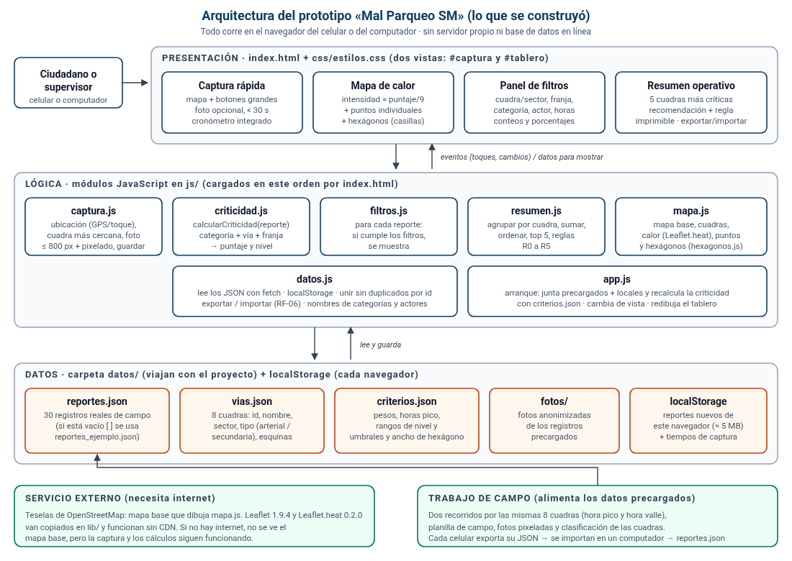

# Diagrama de arquitectura y modelo de datos



Fuente editable: `arquitectura.svg` (se abre en el navegador o en Inkscape/draw.io). Versión PDF lista: `arquitectura.pdf` (para regenerarla: abrir el `.svg` en el navegador → Imprimir → Guardar como PDF). **Ajusten el diagrama si cambian archivos o campos.**

## Flujo del caso CU-01 (reportar)
1. El usuario toca el mapa o usa su ubicación, elige categoría y actor y, si quiere, toma la foto.
2. `captura.js` detecta la cuadra más cercana, reduce la foto a máximo 800 px de ancho (JPEG calidad 0,6) y arma el reporte con fecha y hora.
3. `criticidad.js` busca la cuadra en `vias.json`, deduce la franja por la hora y suma los tres componentes según `criterios.json`.
4. El reporte, ya con su criticidad, se guarda en `localStorage`.
5. `app.js` vuelve a juntar los reportes; `mapa.js` agrega el punto a la capa de calor (y a los hexágonos si están activos) y `resumen.js` recalcula el resumen.

## Modelo de datos

### `datos/reportes.json`: lista de reportes
```json
{
  "id": "MP-20261118-114012-K3F",
  "origen": "campo",
  "fecha_hora": "2026-11-18T11:40",
  "lat": 11.244330, "lng": -74.210397,
  "cuadra": "CR5-C14-C15",
  "categoria": "invasion_anden",
  "actor": "mobiliario_comercial",
  "foto": "fotos/mp-20261118-114012-k3f.jpg",
  "criticidad": { "puntaje": 8, "nivel": "Alto" }
}
```
| Campo | Valores |
|---|---|
| `id` | texto único. La app crea `MP-AAAAMMDD-HHMMSS-XXX` (fecha, hora y 3 letras al azar) para que dos celulares no repitan |
| `origen` | `"campo"` o `"ciudadano"` |
| `fecha_hora` | `"AAAA-MM-DDTHH:MM"`, hora local de Colombia |
| `lat`, `lng` | números (grados) |
| `cuadra` | un `id` de `vias.json` |
| `categoria` | `doble_fila`, `bloqueo_rampa_cebra_paradero`, `invasion_anden` |
| `actor` | `vehiculo_particular`, `motocicleta`, `vehiculo_carga`, `mobiliario_comercial` |
| `foto` | ruta relativa a `datos/` (`"fotos/....jpg"`), imagen en base64 (reportes del navegador) o `null` |
| `criticidad` | `{ puntaje, nivel }`. Se guarda, pero **la app la recalcula al cargar** con el `criterios.json` vigente |

Los registros de `reportes_ejemplo.json` traen además `"ejemplo": true` y un id `EJEMPLO-NN`.

### `datos/vias.json`
```json
{ "zona": "...", "cuadras": [
  { "id": "CR5-C14-C15", "nombre": "Carrera 5 (Av. Campo Serrano) entre calles 14 y 15",
    "sector": "Av. Campo Serrano", "tipo": "arterial",
    "inicio": [11.2446126, -74.2103379], "fin": [11.2440473, -74.2104562] } ] }
```
`inicio` y `fin` son las dos esquinas `[lat, lng]` (cruces tomados de OpenStreetMap). `sector` sirve para el filtro por sector.

### `datos/criterios.json`
Mismas cinco claves del enunciado (`categoria`, `via`, `franja`, `horas_pico`, `niveles`) más `reglas_resumen` con los umbrales de las reglas del resumen operativo:
- `min_altos_en_pico` (3): mínimo de reportes Altos en hora pico para R1.
- `proporcion_predomina` (0,5): fracción a partir de la cual una categoría o actor "predomina" (R2–R5).

Y `mapa_hexagonos.ancho_metros` (50): ancho de cada hexágono de la capa opcional "Ver hexágonos" (`hexagonos.js`). No afecta los puntajes.

## Reglas del resumen operativo (`resumen.js`)
Se revisan todas; cada una que se cumple agrega su recomendación y muestra la regla.
| Regla | Condición (sobre los reportes de la cuadra) | Recomendación |
|---|---|---|
| R1 | reportes de nivel Alto en hora pico ≥ `min_altos_en_pico` | Patrullaje prioritario en hora pico |
| R2 | invasión de andén ≥ `proporcion_predomina` | Operativo de espacio público |
| R3 | actor vehículo de carga ≥ `proporcion_predomina` | Revisar horario de cargue y descargue |
| R4 | doble fila / vía prohibida ≥ `proporcion_predomina` | Control de estacionamiento (comparendos y grúa) |
| R5 | bloqueo de rampa/cebra/paradero ≥ `proporcion_predomina` | Despejar y señalizar rampas, cebras y paraderos |
| R0 | ninguna de las anteriores | Mantener en observación en los recorridos ordinarios |

El resumen se calcula sobre los reportes **filtrados**: si se filtra por franja pico, el top 5 es el de la hora pico.
